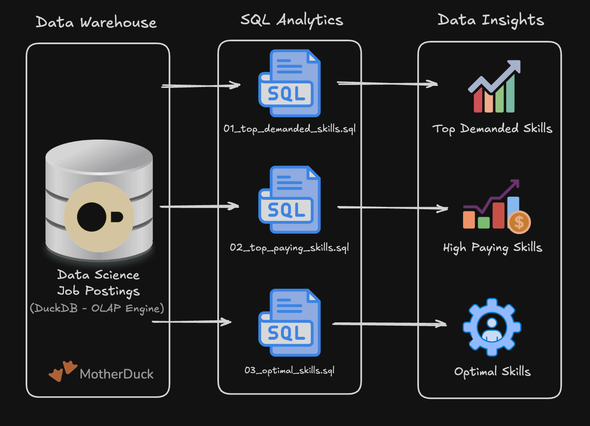
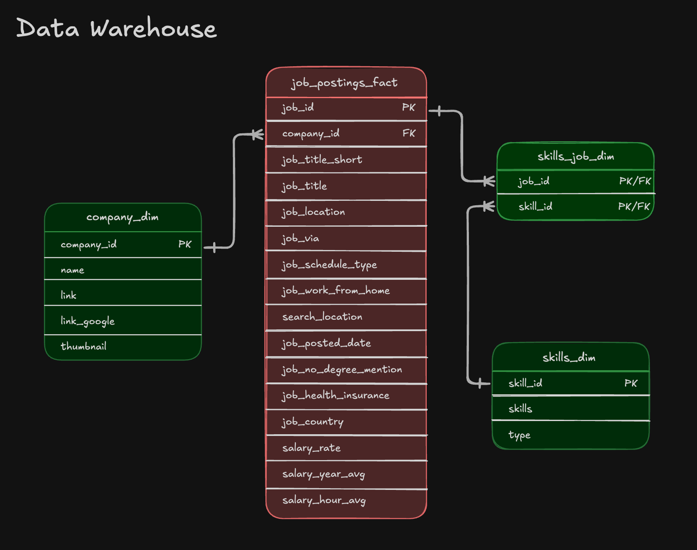

# 🔍 Exploratory Data Analysis w/ SQL: Job Market Analytics

A data engineering project analyzing the **Data Engineer job market** using real-world job posting data. This project demonstrates production-quality analytical SQL, efficient star schema joins, mathematical normalization, and translating raw data into actionable career insights.

---

## 🧾 Executive Summary

* **Project Scope:** Built analytical SQL scripts targeting key data engineering job market metrics.
* **Data Modeling:** Queried across a star schema using multi-table joins (`INNER JOIN`) across fact, dimension, and bridge tables.
* **Analytics & Techniques:** Applied advanced aggregations (`MEDIAN`, `LN`), filtering, grouped statistics, and log-transformation scoring.
* **Key Outcomes:** Identified core skill dominance (SQL/Python), cloud demand (AWS/Azure), high-paying infrastructure tools, and calculated optimal value skills.

---

## 📂 Repository Structure

```text
EDA/
├── 01_top_demanding_skills.sql    # Top 10 most in-demand skills for remote Data Engineers
├── 02_top_paying_skills.sql      # Top 25 highest-paying skills with median salary metrics
├── 03_optimal_skills.sql         # Combined demand & salary score using log transformation
├── warehouse_structure.png       # Entity Relationship Diagram (Star Schema)
├── structure_of_project.png      # Project layout and workflow diagram
└── README.md                     # Project documentation
```

---

## 🧩 Problem & Context

Data engineering job seekers and analysts face three key questions:
1. 🎯 **Most In-Demand:** Which skills have the highest volume of job postings?
2. 💰 **Highest Paid:** Which skills command the highest median compensation?
3. ⚖️ **Optimal Choice:** What is the ideal skill set balancing both high market demand and top-tier pay?

---

## 🏗 Architecture & Project Structure

### Project Layout


### Data Warehouse Architecture (Star Schema)
The data is structured as an OLAP Star Schema inside DuckDB / MotherDuck:



* **Fact Table (`job_postings_fact`):** Stores job postings, pay rates, locations, and posting dates.
* **Dimension Tables (`company_dim`, `skills_dim`):** Store details on companies and technical skills.
* **Bridge Table (`skills_job_dim`):** Handles the many-to-many ($M:N$) relation between jobs and skills.

---

## 🧰 Tech Stack

* **Query Engine:** [DuckDB](https://duckdb.org/) / [MotherDuck](https://motherduck.com/) (High-performance analytical OLAP engine)
* **Language:** SQL (ANSI SQL with advanced mathematical & analytical aggregations)
* **Data Model:** Star Schema (Fact, Dimension, & Bridge tables)
* **Development:** VS Code & DuckDB CLI
* **Version Control:** Git & GitHub

---

## 🏗️ Analysis Overview & Key Insights

### 1. Top Demanded Skills (`top_demanding_skills.sql`)
* **Focus:** Remote Data Engineer positions (`job_work_from_home = True`).
* **Insight:** **SQL** and **Python** lead demand by a wide margin (appearing in ~29,000 job postings), followed by core cloud providers (**AWS** and **Azure**).

### 2. Top Paying Skills (`top_paying_skills.sql`)
* **Focus:** High-compensation skill sets filtering out null pay values.
* **Insight:** Specialized infrastructure and DevOps tools (**Kubernetes**, **Airflow**, **Docker**, **Terraform**) command premium median salaries starting above $150,000/year.

### 3. Optimal Skills (`optimal_skills.sql`)
* **Focus:** Combined metric score formula balancing scale and pay:
  $$\text{Optimal Score} = \frac{\ln(\text{Demand Count}) \times \text{Median Salary}}{1,000,000}$$
* **Insight:** Applying natural logarithm $\ln()$ dampens massive demand numbers so extreme volume does not overwhelm median salary, highlighting high-reward skills with reliable job markets.

---

## 💻 SQL Techniques Demonstrated

* **Multi-Table Joins:** Joining `job_postings_fact`, `skills_job_dim`, and `skills_dim`.
* **Statistical Aggregations:** `MEDIAN()`, `COUNT()`, `ROUND()`.
* **Logarithmic Transformation:** Using `LN()` to normalize skewed demand distributions.
* **Aggregated Filtering:** Filtering groups with `HAVING COUNT(...) >= 100`.
* **Data Cleanliness:** Enforcing `IS NOT NULL` constraints on target metrics.
